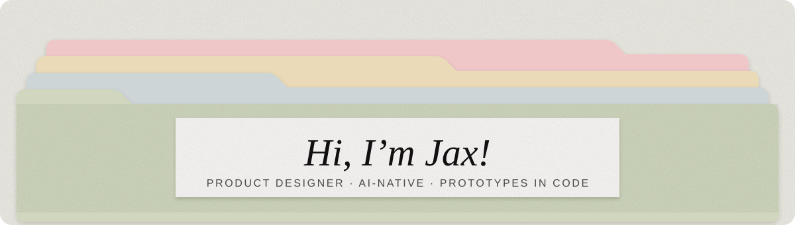
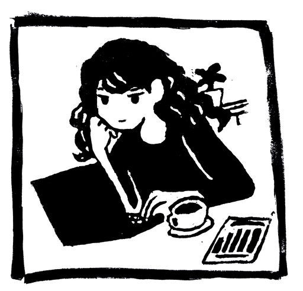
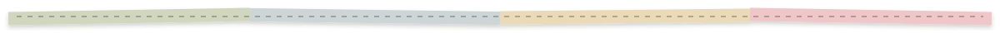

  

  

<h3>About me ✂️</h3>

<table>
<tr>
<td width="64%" valign="top">

**Product Designer**

Product designer and AI-native who prototypes in code. **4+ years** of design experience across healthcare, accessibility, and conservation.

I design accessible, inclusive, playful experiences, and I love data and making fun things. Focus areas: inclusive design, gamification, audio-first experiences, healthcare UX, and game development.

</td>
<td width="36%" align="center" valign="middle">
  
</td>
</tr>
</table>

  

### 🧰 Tools I make with

### Projects

| Project | What it is |
| --- | --- |
| [renpy-inventory-system](https://github.com/JaxLabs/renpy-inventory-system) | Inventory system for Ren'Py visual novels |
| [TowerOfHanoiFinal](https://github.com/JaxLabs/TowerOfHanoiFinal) | Four-disk Tower of Hanoi with visuals and story, built in C++/SFML |
| [python-game-hub](https://github.com/JaxLabs/python-game-hub) | Console and tkinter mini-games |
| [tree-generator](https://github.com/JaxLabs/tree-generator) | Recursive random tree generator in JavaScript |

  

